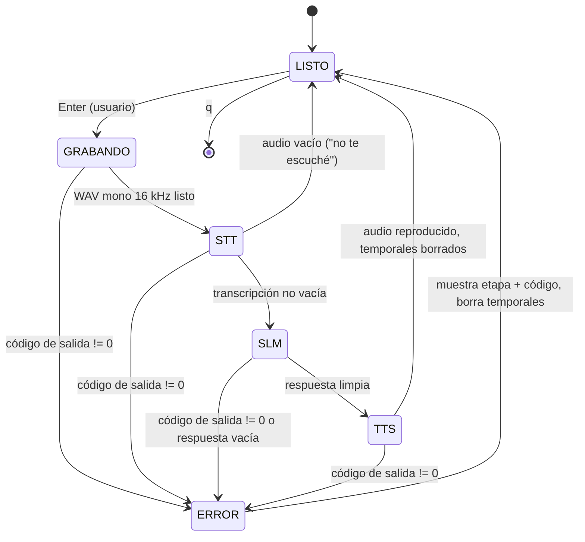

# Etapa 6 · Máquina de estados del orquestador

| Estado | Programa que se lanza | Entrada | Salida |
| --- | --- | --- | --- |
| GRABANDO | `termux-microphone-record` + `ffmpeg` | Voz del usuario (6 s) | `tmp/turno.wav` (PCM 16 bits, mono, 16 kHz) |
| STT | `whisper-cli` (Whisper base) | `tmp/turno.wav` | Texto en español (stdout) |
| SLM | `llama-cli` (Qwen3.5-0.8B Q4_0, `-st`) | Texto + instrucción fija | Respuesta de máx. 96 tokens |
| TTS | `sherpa-onnx-offline-tts` (Piper es_MX) o `termux-tts-speak` | Texto de la respuesta | Audio reproducido |
| ERROR | — | Etapa y código de salida | Mensaje en pantalla y fila en `logs/turnos.csv` |

Reglas de diseño:

- Cada etapa es un proceso aparte lanzado con `fork` + `execvp` y una lista fija de argumentos. El texto transcrito viaja como un argumento más y nunca pasa por una shell, así se evita la inyección de comandos.
- Una etapa termina antes de que empiece la siguiente: nunca hay dos modelos cargados a la vez ni TTS durante la inferencia.
- La memoria pico de cada etapa se mide con `wait4` (`ru_maxrss`) y el tiempo con `steady_clock`.
- `logs/turnos.csv` guarda solo métricas, nunca el texto de la conversación. Los audios temporales se borran al terminar o fallar cada turno.
